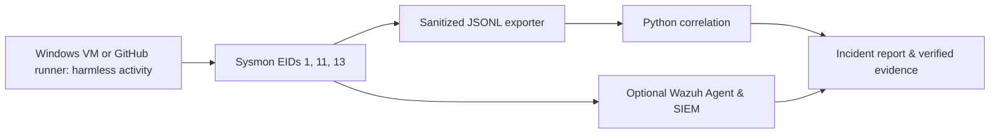

# Windows Screen-Locker Behavior Detection Lab

**Personal Blue-Team Engineering Project** | Windows · Sysmon · Python · Wazuh (optional) · .NET (optional)

> **Verified (2026-11-02):** Python tests and a real GitHub-hosted Windows Server 2022 Sysmon capture passed. Six genuine events with EIDs 1, 11, and 13 were correlated. Wazuh manager alerts and local VM testing remain pending. No malware was used.

## Research question
Can a defensive pipeline capture and correlate process creation (Sysmon EID 1), marker-file creation (EID 11), and registry value changes (EID 13) from a **harmless training application**?

The inspiration is the generic AV label `Trojan-Ransom.MSIL.Blocker.gen`. The AV family label alone does not establish the behavior of any individual sample or confirm any attack occurred today.

## Architecture


## Verified Windows telemetry (2026-11-02)

- [GitHub Actions Run #41489476874](https://github.com/tahazitan/Cybersecurity-Projects/actions/runs/41489476874) **passed** on Microsoft Windows Server 2022.
- **6 genuine Sysmon/Operational records** were exported: EIDs **1**, **11**, and **13**, including a reversible HKCU Run-key training analogue.
- The Python correlator returned `detected: true` and `capture_types: ["real_sysmon"]`. Its **HIGH** label is for this deliberate benign simulation, **not** evidence of actual ransomware.
- A harmless .NET WinForms demo **compiled**, but its GUI was **not executed** on the runner.
- Reproducible, sanitized samples: [actual Sysmon JSONL](evidence/public/windows-real-sysmon-sanitized-2026-11-02.jsonl), [correlation result](evidence/public/windows-real-detection-2026-11-02.json), and [provenance report](evidence/public/hosted-windows-run-41489476874.md).
- Custom Wazuh rules are available but **have not yet been verified on a running Wazuh manager**.

## Current offline validation (runs on macOS)
```bash
python3 -m unittest discover -s tests -v
python3 src/detect_events.py tests/fixtures/synthetic_sysmon.jsonl
```
The provided JSONL is **synthetic fixture data**, not real malware telemetry.

## Optional local Windows VM setup (not yet validated)
1. Use an isolated Windows 10/11 VM. Install Sysmon from [Microsoft Sysinternals](https://learn.microsoft.com/sysinternals/downloads/sysmon), and inspect its schema: `Sysmon64.exe -s`.
2. In elevated PowerShell: `.\Sysmon64.exe -accepteula -i .\lab\sysmon\sysmon-lab.xml`.
3. Run `.\lab\windows\Invoke-BenignScenario.ps1` (optional reversible Run-key test: `-TestRunKey`).
4. Export genuine Sysmon telemetry: `.\lab\windows\Export-LabEvidence.ps1 -OutputPath .\evidence\local\events.jsonl`.
5. Analyze: `py -3 .\src\detect_events.py .\evidence\local\events.jsonl`. Compare observed events with Event Viewer.
6. Only after verified evidence, install Wazuh agent/manager and test custom rules.

## Security and claims
No encryption, screen lock, C2, credential access, malware execution or persistence retained. Tagged behaviors are safe analogues, not an actual ransomware signature. The real exporter intentionally strips user identities, hostnames, full command lines, and internal IPs. Raw evidence stays local and is gitignored. Validate all claims and screenshots before sharing.

**Hardware note:** On the connected 16 GB Intel Mac, VirtualBox and Docker are installed but no Windows VM is present and only ~16 GiB disk was free at setup time. Windows deployment must wait for enough free storage or an external lab disk.

**License:** MIT. Reproducible teaching and detection engineering only.